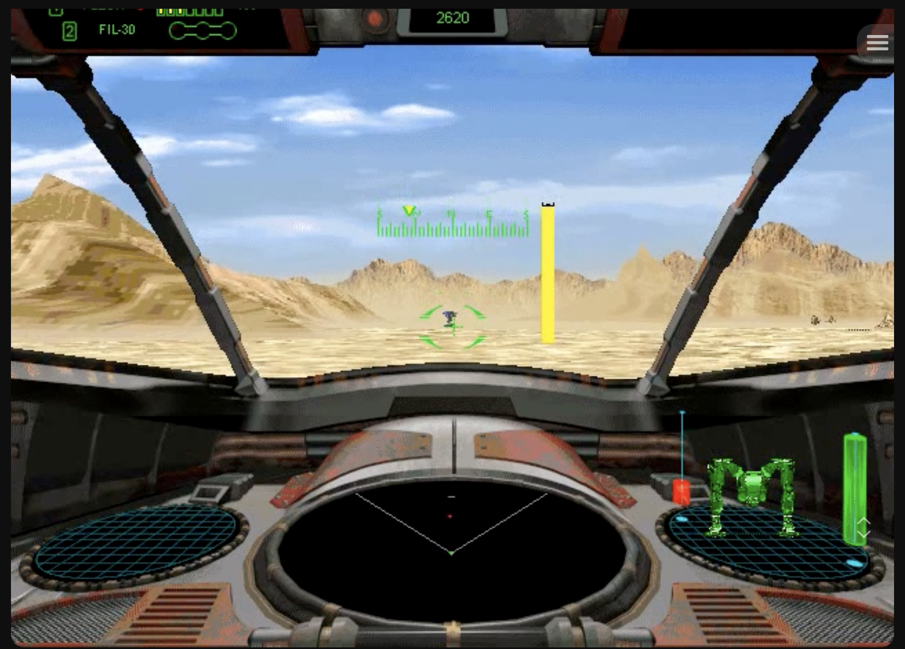

# 製品版1-1の映像観察

- 作品：G-Nome再現
- 媒体：原作プレイ動画・スクリーンショット
- 対象：1-1の敵の索敵、地形、コックピット表示
- 状態：提供画像と公開プレイ動画2本を確認。地形・配置の寸法、巡回ルート、反応条件は未測定
- 記録日：2026-11-05
- 関連：[1-1仕様](../../../missions/mission-1-1.md)、[敵AI](../../../gameplay/enemy-behavior.md)、[機内表示](../../../gameplay/cockpit-hud.md)、[BGM対応表](../../../audio/bgm-mapping.md)

## 観察001：敵Sentryに気づかれた場面

| 項目 | 記録 |
| --- | --- |
| 出典 | [YouTube・1:06](https://www.youtube.com/watch?v=3qxed6EscRQ&t=66s) |
| 動画内時刻 | 00:01:06。ゲーム開始からの経過時間とは区別 |
| ユーザーの観察 | この距離で敵Sentry HAWCに気づかれた |
| 対象 | 会話の文脈では製品版1-1のMerc Sentry。機種の根拠はユーザーの説明 |
| 難易度・言語版 | この画像からは未確認 |
| 距離 | 数値未確認。画像からmへ換算していない |
| IFF | 画像上部の表示は2620。この任務での所属・識別先との対応は未確認 |
| 保存画像 | [提供スクリーンショット](youtube-3qxed6EscRQ-01m06s.png)。1652×1186px、原画像を変更せず保存 |
| 確認方法 | 提供画像を目視。動画の前後の動き・音は直接視聴できていない |

### 画像で確認できること

砂色の地形と山のある開けた場所で、遠方の機体が画面中央の緑の照準付近に小さく見える。レーダーには中央付近に赤い点が見える。機内には左右の斜めの支柱、下部中央の黒い楕円状レーダー、右の緑の自機Holoとバー、上部左のFIL-30表記がある。

左の目標Holoは、この画像では機体像が表示されていない。上部が一部切れており、動画プレイヤー側と思われるメニューや矢印の重なりもある。これらの重なりを原作コックピットの部品として再現しない。

ユーザーの追加確認により、Union Sentryの武器スロット1はFLECH機関銃、2はFIL-30レーザー。この画像では1番の表示が切れているため、1番の確認根拠はユーザーの説明とし、画像から読み取れたとは記録しない。

会話上はUnion Sentryで交戦する場面の資料として扱うが、画像内の文字だけで自機名を確定したわけではない。機体名表示がある別の場面と対応づけて照合する。

### 索敵条件の扱い

「この時点で敵に気づかれた」というユーザーの観察を保存する。単一画像では、敵の索敵判定が成立した最初の瞬間、接近や射撃の開始、索敵範囲の上限を特定できない。

自機レーダーの赤点は、自機が敵と識別している表示であり、相手が自機を検知したことの単独の証明にはしない。Ping Lightの状態、相手の向き・移動・発射など、前後の変化も確認する。

開けて見えることだけから、AIが視界判定を使うと確定しない。距離、地形、ウェイポイント・領域のイベント、先行する交戦や発砲、IFFなど、反応の契機を分けて調べる。

### 次に確認する箇所

1:06の直前と直後を見て、敵が向きを変える、動き出す、射撃する、Ping Lightが変化する時刻を記録する。可能なら敵を選択・ロックして距離が表示される場面も照合する。

敵の画面上の大きさだけから距離を算出しない。視野角・画像の拡大・切り抜き・地形の高さが未確定なため、この画像は索敵時の見た目の比較資料とする。BGMについても、画像だけでは曲や切り替えを確認していない。

## 実装着手時の動画確認

参照：[DarkShadowRageの動画](https://www.youtube.com/watch?v=3qxed6EscRQ)、[j-boxの1-1攻略動画](https://www.youtube.com/watch?v=ouTQ_oUpzWA)。Chromeで両ページを開いて一部の画面を確認した。j-boxの任務画面では「Head for waypoint one」「Primary: Destroy Merc raiding party」を確認した。徒歩時には機体と異なる、ゴーグル状の枠とGASHRの表示が見える。

この時点では全区間を連続再生して動きを測定していなかった。その後の調査を以下に記録する。敵の周回半径、速度、発射間隔、地形・配置の寸法は引き続き未測定であり、実装値を動画から確定した数値とは扱わない。

## 観察002：1-1の地形と敵との遭遇順

2026-11-05に[DarkShadowRageの動画](https://www.youtube.com/watch?v=3qxed6EscRQ)の1-1全区間（動画内0:00～3:04）と、[j-boxの動画](https://www.youtube.com/watch?v=ouTQ_oUpzWA)の任務画面・プレイ区間を確認した。以下の時刻は動画内の目安であり、ゲーム内の経過時間ではない。

| DarkShadowRage動画の時刻 | 画面で確認できること |
| --- | --- |
| [0:00～0:20](https://www.youtube.com/watch?v=3qxed6EscRQ&t=0s) | 徒歩で開始し、正面のUnion機へ向かって搭乗する。出発地点の周囲には大きな砂色の岩壁がある。 |
| [0:30～1:10](https://www.youtube.com/watch?v=3qxed6EscRQ&t=30s) | 岩壁沿いに進むと、砂地が開け、遠方の尾根が見える。黄色いウェイポイント表示、散在する岩と低木が見える。障害物の数や位置は画角内に限られる。 |
| [1:20～1:45](https://www.youtube.com/watch?v=3qxed6EscRQ&t=80s) | 青系のMerc機1機と接近戦になる。岩と尾根のある開けた場所で交戦する。 |
| [2:40～3:04](https://www.youtube.com/watch?v=3qxed6EscRQ&t=160s) | さらに別のMerc機1機と交戦し、撃破直後に「MISSION ACCOMPLISHED」と表示される。 |

[GameFAQsの1-1攻略記録](https://gamefaqs.gamespot.com/pc/197456-g-nome/faqs/14087)も、WP1到達後にWP2へ向かい、Merc機と2回交戦して2機目の撃破で任務が終わる順序を説明している。動画で見える2回の交戦と整合する。ただし、この攻略記録だけでは各敵の機種・初期位置を確定できない。1機目の周回、2機目のジグザグという行動の説明も、定量的な巡回ルートや機種への割り当てには使わない。

### 地形・配置の確定範囲

- 出発地点は岩壁に近く、進行先には開けた砂地と周囲の尾根がある。岩と低木が点在する。壁・岩・低木の全体配置と寸法は、移動するカメラの映像だけでは復元できない。
- 1-1に登場し、撃破対象になるMerc機は、確認したプレイ例では2機。自機のUnion機を含めて3機が画面に現れる。難易度による増減や、画面外の非目標機の有無は未確認。
- WP1の後にWP2の表示があることは攻略記録で確認できる。j-box動画の任務画面には地形の概略図があるが、座標目盛りや原点は読めない。WP1・WP2の正確な座標をこの資料から決めない。
- 敵2機の開始時の位置・向き・待機状態、移動前の巡回ルートは見えない。交戦中の動きから初期配置を逆算しない。距離表示は移動中の自機と敵との相対距離であり、絶対座標ではない。

任務定義の地形寸法、岩の座標、WP1の`(0, 215)`、敵の`(-24, 185)`と`(22, 315)`は試作用の仮値。今回の映像でこれらの数値を裏付けたものではない。正確な座標と巡回経路を確定するには、製品版のレベルデータ、または座標・縮尺が読める実機マップと移動前の敵位置の記録が必要。
