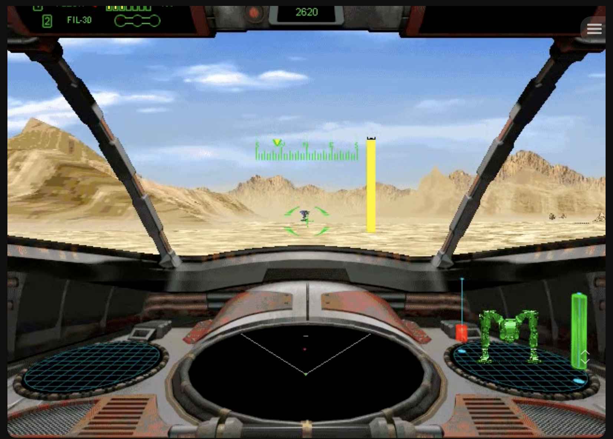

# 製品版1-1の映像観察

- 作品：G-Nome再現
- 媒体：原作プレイ動画・スクリーンショット
- 対象：1-1の敵の索敵、地形、コックピット表示
- 状態：ユーザー提供の観察と画像を記録。距離・難易度・反応条件は未測定
- 記録日：2026-10-22
- 関連：[1-1仕様](../../../missions/mission-1-1.md)、[敵AI](../../../gameplay/enemy-behavior.md)、[機内表示](../../../gameplay/cockpit-hud.md)、[BGM対応表](../../../audio/bgm-mapping.md)

## 観察001：敵Sentryに気づかれた場面

| 項目 | 記録 |
| --- | --- |
| 出典 | [YouTube・1:06](https://www.youtube.com/watch?v=3qxed6EscRQ&t=66s) |
| 動画内時刻 | 00:01:06。ゲーム開始からの経過時間とは区別 |
| ユーザーの観察 | この距離で敵Sentry HAWCに気づかれた |
| 対象 | 会話の文脈では製品版1-1のMerc Sentry。機種の根拠はユーザーの説明 |
| 難易度・言語版 | この画像からは未確認 |
| 距離 | 数値未確認。画像からmへ換算していない |
| IFF | 画像上部の表示は2620。この任務での所属・識別先との対応は未確認 |
| 保存画像 | [提供スクリーンショット](youtube-3qxed6EscRQ-01m06s.png)。1652×1186px、原画像を変更せず保存 |
| 確認方法 | 提供画像を目視。動画の前後の動き・音は直接視聴できていない |

### 画像で確認できること

砂色の地形と山のある開けた場所で、遠方の機体が画面中央の緑の照準付近に小さく見える。レーダーには中央付近に赤い点が見える。機内には左右の斜めの支柱、下部中央の黒い楕円状レーダー、右の緑の自機Holoとバー、上部左のFIL-30表記がある。

左の目標Holoは、この画像では機体像が表示されていない。上部が一部切れており、動画プレイヤー側と思われるメニューや矢印の重なりもある。これらの重なりを原作コックピットの部品として再現しない。

ユーザーの追加確認により、Union Sentryの武器スロット1はFLECH機関銃、2はFIL-30レーザー。この画像では1番の表示が切れているため、1番の確認根拠はユーザーの説明とし、画像から読み取れたとは記録しない。

会話上はUnion Sentryで交戦する場面の資料として扱うが、画像内の文字だけで自機名を確定したわけではない。機体名表示がある別の場面と対応づけて照合する。

### 索敵条件の扱い

「この時点で敵に気づかれた」というユーザーの観察を保存する。単一画像では、敵の索敵判定が成立した最初の瞬間、接近や射撃の開始、索敵範囲の上限を特定できない。

自機レーダーの赤点は、自機が敵と識別している表示であり、相手が自機を検知したことの単独の証明にはしない。Ping Lightの状態、相手の向き・移動・発射など、前後の変化も確認する。

開けて見えることだけから、AIが視界判定を使うと確定しない。距離、地形、ウェイポイント・領域のイベント、先行する交戦や発砲、IFFなど、反応の契機を分けて調べる。

### 次に確認する箇所

1:06の直前と直後を見て、敵が向きを変える、動き出す、射撃する、Ping Lightが変化する時刻を記録する。可能なら敵を選択・ロックして距離が表示される場面も照合する。

敵の画面上の大きさだけから距離を算出しない。視野角・画像の拡大・切り抜き・地形の高さが未確定なため、この画像は索敵時の見た目の比較資料とする。BGMについても、画像だけでは曲や切り替えを確認していない。

## 実装着手時の動画確認

参照：[DarkShadowRageの動画](https://www.youtube.com/watch?v=3qxed6EscRQ)、[j-boxの1-1攻略動画](https://www.youtube.com/watch?v=ouTQ_oUpzWA)。Chromeで両ページを開いて一部の画面を確認した。j-boxの任務画面では「Head for waypoint one」「Primary: Destroy Merc raiding party」を確認した。徒歩時には機体と異なる、ゴーグル状の枠とGASHRの表示が見える。

全区間を連続再生して動きを測定した段階ではない。敵の周回半径、速度、発射間隔、地形・配置の寸法は未測定であり、実装値を動画から確定した数値とは扱わない。その後、ユーザーの指定によりComputer Useを停止した。
