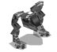

# Union Sentry HAWCのデザイン資料

- 作品：G-Nome再現
- 媒体：ブラウザゲーム制作の原作資料
- 対象：ユニオン軍セントリーホーク（Prowler）の外観とコックピット
- 状態：原作マニュアル画像とユーザー提供のゲーム画面を保存済み。提供画像内の勢力・機種の対応はユーザー指定。背面・側面の詳細は未確認
- 保存日：2026-10-23
- 関連：[機体と武器](../../vehicles-and-weapons.md)、[コックピット](../../../gameplay/cameras-and-cockpits.md)

別機種や任務画面の資料は[画像の保存先一覧](../README.md)から参照する。

## 保存画像

| ファイル | 内容 |
| --- | --- |
| [exterior-manual.jpg](exterior-manual.jpg) | 機体の外観。72×66ピクセル。PDF内のJPEGを再圧縮せず抽出 |
| [cockpit-manual.jpg](cockpit-manual.jpg) | コックピット。620×480ピクセル。PDF内のJPEGを再圧縮せず抽出。元から右側が白く薄れた誌面用画像 |
| [manual-p22.png](../../manuals/manual-p22.png) | 機体名・仕様と画像の対応を確認できる掲載ページ全体 |
| [user-sentry-identification-2026-10-23.png](user-sentry-identification-2026-10-23.png) | ユーザー提供のゲーム画面。右下がUnion Sentry、正面の青い機体と左下がMerc Sentry |

## 出典と確認範囲

[保存済み英語マニュアル](../../manuals/G-Nome_Manual_Win_EN.pdf)の本文22ページ（PDF24ページ目）から取得した。[PDFの入手元とハッシュ](../../sources-and-macos.md)を参照。`pdfimages -f 24 -l 24 -j`で埋め込み画像を抽出し、`pdftoppm`でページ全体を画像化した。

ページ上段の「Union Sentry HAWC (Prowler)」に対応する外観・コックピットを目視で確認した。下段のUnion Tactical Defense HAWCとは分けて保存している。左右の高い脚部と、脚の間に低く位置する中央胴体が外観の手がかりになる。ただし、この小さな白黒画像だけでは配色・細部・各方向の形状は確定できない。

[Union Sentry HAWC / G-Nome Wiki](https://g-nome.fandom.com/wiki/Union_Sentry_HAWC)にも機体画像へのリンクがあるが、画像取得はHTTP 403で失敗したため保存・画像照合はできていない。ファン制作モデルは原作デザインの確定資料として採用していない。資料の抽出時点ではゲーム内モデルを変更していない。

## ユーザー指定の配色（2026-10-23）

ユーザーの訂正により、Union Sentryはグレーと赤、Merc Sentryは濃い青と黒を使う。試作のUnion Sentryは装甲をグレー（`#85898c`）、武装ポッドとすねの装甲を赤（`#983f3b`）に変更した。Merc Sentryは装甲を濃い青（`#17365f`）、コックピット周りを黒（`#090d13`）、窓を暗い色（`#0d1722`）にする。Merc Tactical Defenseの配色は個別に扱う。

指定の配色はユーザー提供の情報であり、白黒のマニュアル画像で色を確認できたという意味ではない。色コードと現在の簡易モデル形状は試作上の値で、原作の色・形状との厳密な照合は残っている。

## ユーザー提供画像による機体の識別（2026-10-23）

[提供画像](user-sentry-identification-2026-10-23.png)内の対応は、ユーザーが次のように指定した。

| 画像内の位置 | 機体 | 見えている特徴 |
| --- | --- | --- |
| 右下のホログラム | Union Sentry HAWC | 中央胴体が低く、左右の肩・武装部が高い。左右に離れた脚と、横幅の広い輪郭 |
| 正面の青い機体 | Merc Sentry HAWC | 大きな箱形の上部、黒い前面窓、左右へ張り出す武装部、青を基調として赤や明るい色のパネルがある脚 |
| 左下のホログラム | Merc Sentry HAWC | 正面の青い機体に対応する形状。一方の脚の一部が黄色の損傷表示 |

Union Sentryの形状を確認するときは、正面の青い機体ではなく右下のホログラムを参照する。左右のホログラムの緑や黄色は表示・損傷状態の色であり、外装の塗装色として採用しない。

右下の像は小さなホログラムのため、表面の意匠や武装の細部、背面・側面の形状までは確定しない。Union Sentryのグレーと赤という配色は、上記のユーザー指定を維持する。

## 試作モデルへの反映（2026-10-23）

ユーザー指定により、提供画像の識別に沿って3Dモデルとホログラムを変更した。Union Sentryは低い中央胴体、高い左右の肩・武装ポッド、離れた脚を持つ輪郭にした。Merc Sentryは背の高い箱形キャビン、大きな黒い前面窓、左右へ張り出す武装、青い装甲と赤いパネルを持つ形にした。

部位の配置・主要寸法は [vehicle-shapes.ts](../../../../src/game/content/vehicle-shapes.ts) にまとめ、3Dモデルと部位の当たり判定で共有する。ホログラムも両軍の輪郭を分け、既存の部位別損傷色と歩行動作を維持する。寸法と細部は提供画像をもとにした試作値であり、原作モデルの厳密な復元ではない。

## 旋回についてのユーザー指定（2026-10-24）

作品：G-Nome／媒体：ブラウザゲーム／対象：Union Sentry HAWC／状態：ユーザーの補足で確定。実装へ反映済み。

Union Sentry HAWCは車体の向きを変えられるが、上半身・照準だけを左右に回すことはできない。上部の独立した横旋回は固定とする。上下照準の制限は今回の指定に含まれない。[機体の可動仕様](../../../gameplay/vehicle-articulation.md#union-sentryの確定仕様2026-10-24)を参照する。

共通機体定義を`torsoLimit: 0`へ修正した。手動の横照準・追尾・AI・描画・命中領域で上半身の独立旋回を禁止し、車体全体の方向転換は維持する。

## M字型の外観の修正（2026-10-24）

ユーザーの最新指定に合わせ、上段の[マニュアル画像](../../manuals/manual-p22.png)と[提供画像の右下ホログラム](user-sentry-identification-2026-10-23.png)を再確認した。左右の脚・肩が高く、中央の胴体・コックピットが低いM字型として再構成した。正面の青いMerc Sentryと、マニュアル下段のUnion Tacticalは別機種として扱う。

3Dモデルでは横一文字の肩の梁を取り除き、左右の高い肩から低い中央胴体へ下がる斜めの支持部を追加した。脚の間隔を広げ、肩まで伸びる脚上部を追加した。中央胴体・肩・武装部・脚上部の寸法は`vehicle-shapes.ts`で共有し、命中領域も合わせて更新した。ホログラムも高い両肩と低い中央を持つ輪郭へ修正し、機内視点の高さを中央コックピットに合わせた。

全高6.8mと機体性能、グレーと赤の配色は維持する。横幅・各部の寸法・斜めの支持部・細部の意匠は、限られた画像を基にした試作値。側面・背面の厳密な原作照合は残っている。

ユーザーの追加指定により、FLECH・FIL-30の発射部をコックピット下へ配置した。高い左右の装甲は肩・脚側の構造として扱い、肩から弾を出さない。FIL-30は左右二門から同時に発射する。銃口の描画、プレイヤーとAIの射撃開始位置、武装の命中領域を同じ共有寸法へ合わせる。左右の銃口位置と細部は試作値で、元の威力・消費量・射撃間隔は維持する。
